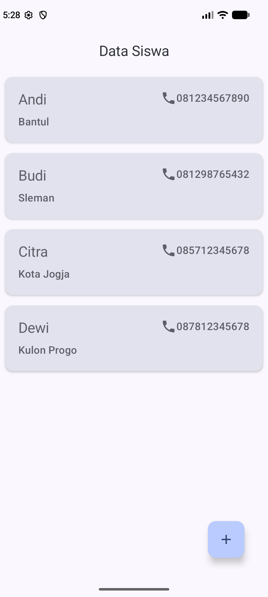
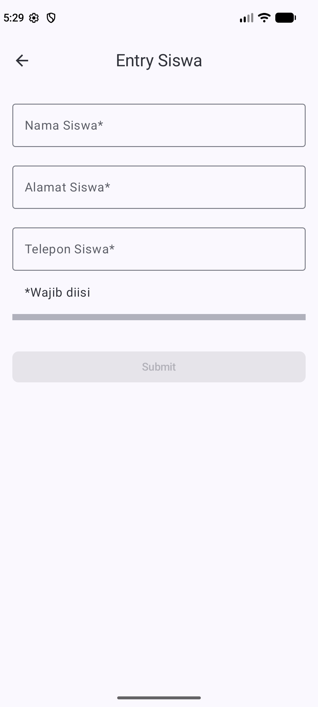
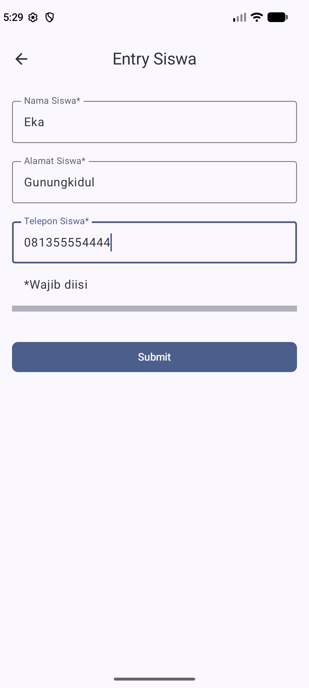
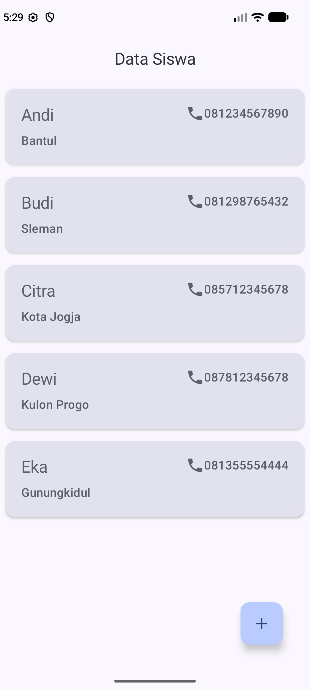

# QuestAPI_0010

Aplikasi Android (Jetpack Compose) untuk menampilkan dan menambah **data siswa** melalui REST API sederhana berbasis **PHP + MySQL (XAMPP)**. Aplikasi memakai **Retrofit** dan **kotlinx.serialization** untuk komunikasi dengan server.

## Fitur

- Menampilkan daftar siswa dari database (`GET bacaTeman.php`)
- Menambah data siswa baru melalui form Entry (`POST insertTM.php`)
- Status loading dan error saat memuat data
- Navigasi Home ↔ Entry dengan Navigation Compose

## Screenshot

| Halaman Data Siswa | Halaman Entry Siswa |
|:---:|:---:|
|  |  |

| Form Entry Terisi | Hasil Penambahan Data |
|:---:|:---:|
|  |  |

Setelah menekan **Submit**, data **Eka – Gunungkidul – 081355554444** tersimpan ke database dan langsung muncul di halaman Data Siswa.

## Struktur Project

```
app/src/main/java/com/example/pertemuan11/
├── apiservice/      ServiceApiSiswa.kt     (endpoint Retrofit)
├── modeldata/       DataSiswa.kt           (model data)
├── repositori/      ContainerApp.kt, RepositoryDataSiswa.kt
├── viewmodel/       HomeViewModel.kt, EntryViewModel.kt, provider/
├── view/            HomeScreen.kt, EntrySiswaScreen.kt, AppBar.kt, route/, uicontroller/
└── MainActivity.kt
php/
├── koneksi.php      koneksi ke database TIUMY
├── bacateman.php    menampilkan data teman (JSON)
├── insertTM.php     menambah data teman
└── tiumy.sql        struktur + data tabel teman
```

## Cara Menjalankan

1. **Database**: jalankan Apache dan MySQL di XAMPP, lalu import `php/tiumy.sql` lewat phpMyAdmin.
2. **API**: salin isi folder `php/` ke `C:\xampp\htdocs\umyTI\`.
   Sesuaikan `$port` di `koneksi.php` dengan port MySQL XAMPP kamu (di project ini `3307`).
3. **Cek API**: buka `http://localhost/umyTI/bacaTeman.php`, hasilnya harus berupa JSON.
4. **Emulator**: teruskan port ke laptop dengan adb reverse (diulang setiap emulator dinyalakan):
   ```
   adb reverse tcp:8080 tcp:80
   ```
   Base URL di `ContainerApp.kt` adalah `http://127.0.0.1:8080/umyTI/`.
   Jika emulator bisa mengakses host secara langsung, bisa juga memakai `http://10.0.2.2/umyTI/`.
5. Jalankan aplikasi dari Android Studio.

## Teknologi

- Kotlin, Jetpack Compose, Material 3
- Navigation Compose, ViewModel
- Retrofit + kotlinx.serialization converter
- PHP 8 + MySQL/MariaDB (XAMPP)
